# Design a Rate Limiter

## Table of Contents

1. [What is a Rate Limiter?](#1-what-is-a-rate-limiter)
2. [Why is a Rate Limiter Important?](#2-why-is-a-rate-limiter-important)
3. [Where to Implement Rate Limiting](#3-where-to-implement-rate-limiting)
   - [3.1 Client-Side Rate Limiting](#31-client-side-rate-limiting)
   - [3.2 Server-Side Rate Limiting](#32-server-side-rate-limiting)
   - [3.3 Middleware-Side Rate Limiting](#33-middleware-side-rate-limiting)
4. [Rate Limiting Based On](#4-rate-limiting-based-on)
   - [4.1 IP Based](#41-ip-based)
   - [4.2 User ID Based](#42-user-id-based)
5. [Rate Limiting Algorithms](#5-rate-limiting-algorithms)
   - [5.1 Token Bucket Algorithm](#51-token-bucket-algorithm)
   - [5.2 Leaky Bucket Algorithm](#52-leaky-bucket-algorithm)
   - [5.3 Token Bucket vs Leaky Bucket](#53-token-bucket-vs-leaky-bucket)
6. [High-Level Architecture](#6-high-level-architecture)
   - [6.1 Why Redis Instead of Local Memory?](#61-why-redis-instead-of-local-memory)
7. [What Happens When a Request Is Blocked](#7-what-happens-when-a-request-is-blocked)
8. [Summary](#8-summary)

---

## 1. What is a Rate Limiter?

A **rate limiter** is a tool that controls how many requests a client (or a service) can send to a server in a fixed amount of time.

In the HTTP world, a rate limiter limits the number of client requests allowed over a specific period. If the number of API requests goes above the limit defined by the rate limiter, all the extra requests are **blocked**.

**Simple analogy:** Think of a highway. Only a limited number of cars can pass through per minute. If too many cars enter at once, traffic jams happen. A rate limiter works the same way for a server. It allows only a limited number of requests, so the server is not overloaded.

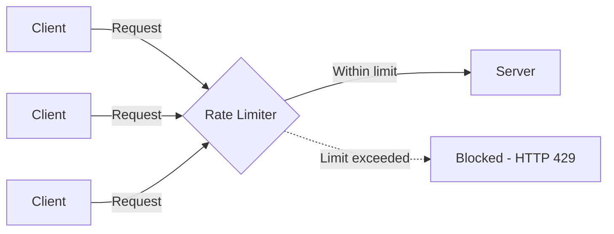

---

## 2. Why is a Rate Limiter Important?

| Reason | Simple Explanation |
|---|---|
| **Prevents server overload** | The server does not crash when too many requests come at once. |
| **Protects against DoS / DDoS attacks** | Attackers cannot flood the server with millions of requests. |
| **Stops brute-force attacks** | Limits repeated login or password attempts. |
| **Fair usage** | One heavy user cannot slow down the service for everyone else. |
| **Cost control** | Saves money on servers, bandwidth, and third-party API calls (which are often paid per request). |
| **Protects downstream services** | Databases and other services behind the API stay safe. |
| **Better reliability and user experience** | The service stays fast and available for normal users. |

---

## 3. Where to Implement Rate Limiting

There are three main places where we can apply rate limiting.

### 3.1 Client-Side Rate Limiting

The client (browser, mobile app, or another program) limits its own request rate before sending requests to the server.

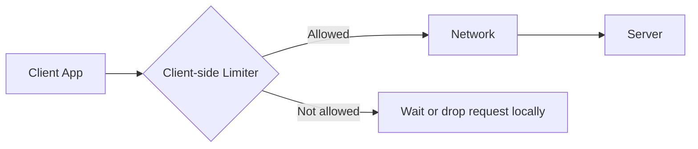

**Pros:**
- Reduces unnecessary network calls.
- Saves the client's own resources.

**Cons:**
- **Not reliable for security.** A hacker can easily bypass client-side code.
- Clients can be modified, so the server cannot trust them to limit themselves.

**Use case:** Good for being polite to an API and avoiding your own app's mistakes, but never the only protection.

---

### 3.2 Server-Side Rate Limiting

The actual web server (application server) checks each request and decides whether to allow it.

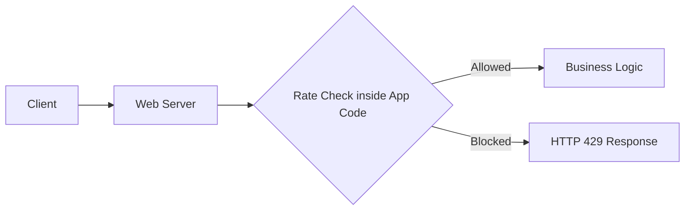

**Pros:**
- Full control over the logic.
- Can use detailed business rules.

**Cons:**
- The rate limiting code must be written in **every service**.
- Requests already reach the server before being blocked, so the server still uses some resources.
- Hard to keep consistent across many servers.

---

### 3.3 Middleware-Side Rate Limiting

A **middleware** sits between the client and the server (for example, an API Gateway, Load Balancer, or Reverse Proxy such as NGINX, Kong, or AWS API Gateway). All requests pass through it first, and the middleware decides whether to forward them.

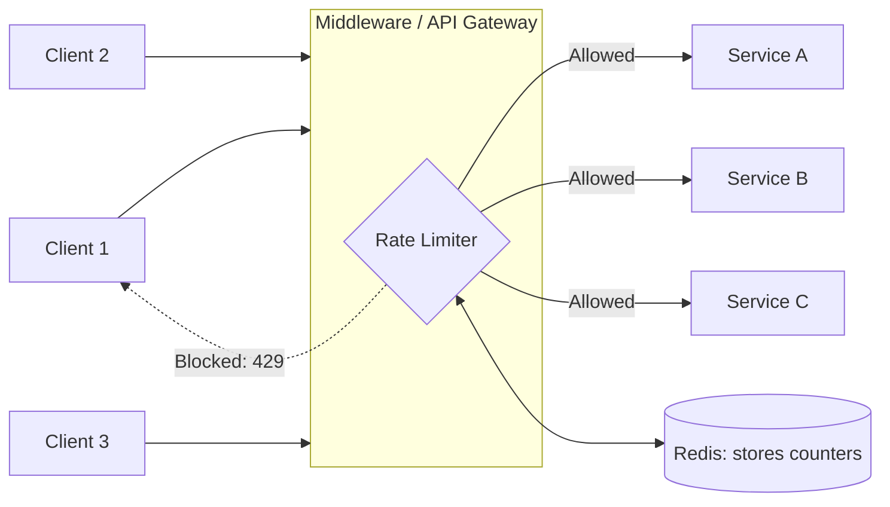

**Why middleware-side rate limiting is the most used in the industry:**

1. **Centralized:** One place controls the rules for all services. No need to write the same code again and again.
2. **No change in application code:** Developers focus on business logic, not on rate limiting.
3. **Blocks bad traffic early:** Blocked requests never reach the backend, saving CPU, memory, and database load.
4. **Works for any language or framework:** Services can be written in Java, Python, Node.js, or Go. The middleware does not care.
5. **Scales well:** Middleware can be run as many instances and share counters through a fast store like **Redis**.
6. **Easy to update:** Limits can be changed in one config file without redeploying every service.
7. **Supports microservices:** In microservice architectures, a single gateway handles limits for hundreds of services.

Because of these reasons, companies like **Amazon, Google, Stripe, GitHub, and Twitter/X** use gateway or middleware based rate limiting for their public APIs.

---

### Comparison of the Three Approaches

| Feature | Client-Side | Server-Side | Middleware-Side |
|---|---|---|---|
| Security | Weak | Good | **Strong** |
| Central control | No | No | **Yes** |
| Code change needed | Client code | Every service | **None (config only)** |
| Blocks bad traffic early | No | Partly | **Yes** |
| Industry usage | Low (supporting role) | Medium | **High (most common)** |

---

## 4. Rate Limiting Based On

Rate limits must be applied to a specific **identifier**. The two most common identifiers are IP address and User ID.

### 4.1 IP Based

Each **IP address** gets its own limit. For example: *"Each IP can send 100 requests per minute."*

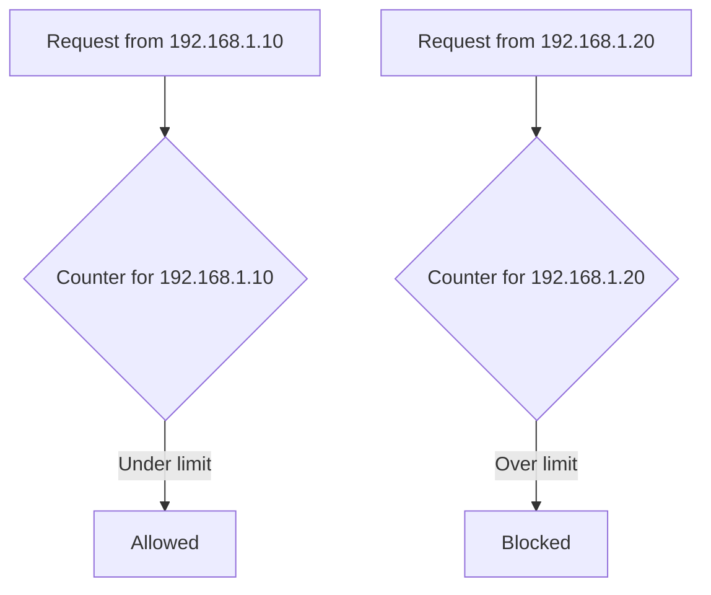

**Pros:**
- Works even when users are **not logged in**.
- Easy to implement.
- Good for stopping attackers from one machine.

**Cons:**
- Many users behind the same **NAT / office / mobile network / public Wi-Fi** share one IP. One user may get blocked because of another user's behavior.
- Attackers can use many IPs (proxies, botnets) to bypass the limit.

---

### 4.2 User ID Based

Each **logged-in user** (identified by user ID, account ID, or API key) gets its own limit. For example: *"Each user can make 1000 API calls per hour."*

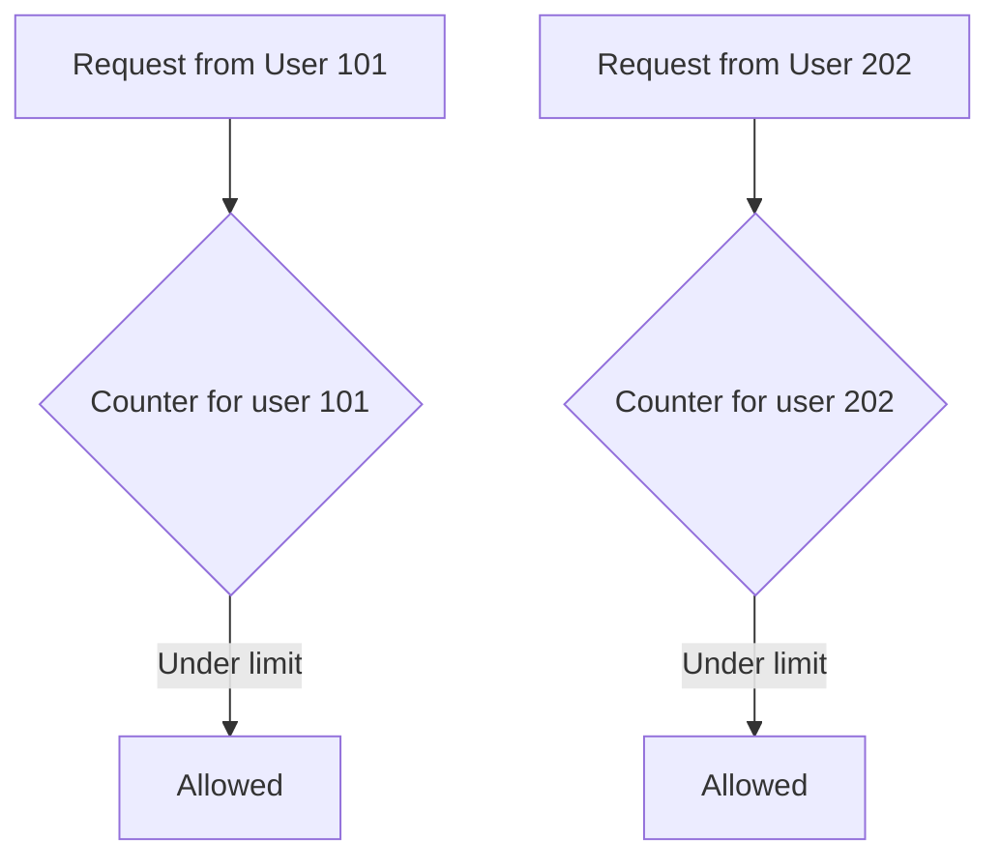

**Pros:**
- Fair: each real user gets their own quota.
- Different plans can have different limits (Free, Pro, Enterprise).
- Not affected by shared IP addresses.

**Cons:**
- The user must be **identified first** (login or API key is needed).
- Requests from unauthenticated users need another method (often IP based).

**Good practice:** Use **User ID for logged-in traffic** and **IP for anonymous traffic** together.

---

## 5. Rate Limiting Algorithms

An algorithm decides **how** requests are counted and allowed. The two most popular ones are **Token Bucket** and **Leaky Bucket**.

---

### 5.1 Token Bucket Algorithm

**Simple English idea:**
- Imagine a bucket that holds **tokens**.
- The bucket has a **maximum capacity** (for example, 5 tokens).
- Tokens are added to the bucket at a **fixed refill rate** (for example, 1 token per second).
- Each incoming request **takes one token** from the bucket.
- If the bucket is **empty**, the request is **blocked**.
- If the bucket is **full**, new tokens are thrown away (the bucket cannot go above capacity).

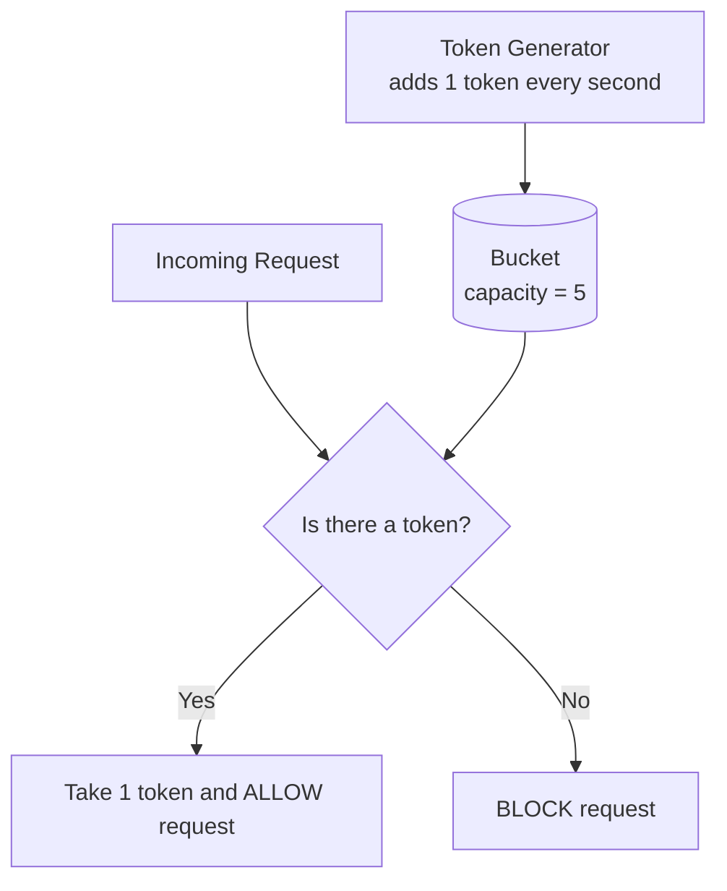

**Example walkthrough** (capacity = 5, refill = 1 token per second):

| Time | Tokens in bucket (before request) | Requests arriving | Result |
|---|---|---|---|
| t = 0 s | 5 | 5 requests | All 5 allowed, bucket becomes 0 |
| t = 0 s | 0 | 1 more request | **Blocked** (no tokens) |
| t = 1 s | 1 (refilled) | 1 request | Allowed, bucket becomes 0 |
| t = 5 s | 5 (full again) | 8 requests | First 5 allowed, last 3 **blocked** |

**Key feature:** It **allows short bursts** of traffic, as long as the average rate stays within the refill rate.

**Pros:**
- Allows bursts of traffic (good for real users who click many times quickly).
- Simple and memory-efficient (only need to store token count and last refill time).
- Very popular in industry (used by Amazon and Stripe style APIs).

**Cons:**
- Tuning two values (capacity and refill rate) needs some care.

---

### 5.2 Leaky Bucket Algorithm

**Simple English idea:**
- Imagine a bucket with a **hole at the bottom**.
- Incoming requests are **poured into the bucket** (added to a queue).
- Water (requests) **leaks out at a constant rate** (requests are processed at a fixed speed).
- If the bucket is **full**, new requests **overflow and are dropped**.

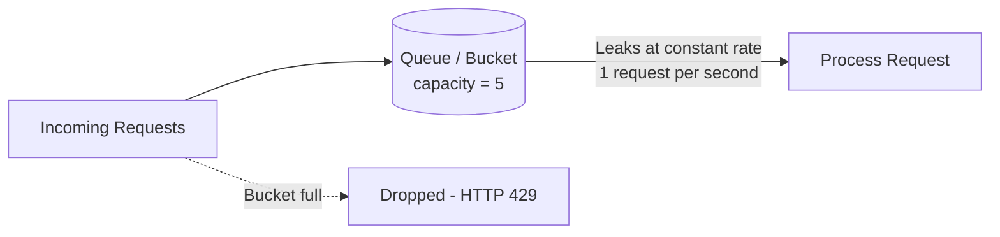

**Example walkthrough** (queue capacity = 5, leak rate = 1 request per second):

- 10 requests arrive at the same time.
- 5 requests fit into the queue. The other 5 are **dropped**.
- The server processes the 5 queued requests **one per second**, so the output is always smooth.

**Key feature:** It produces a **smooth and steady output rate**, no matter how bursty the input is.

**Pros:**
- Very stable and predictable output rate.
- Good for systems that need a constant processing speed (for example, sending emails, payment processing, or writing to a slow database).
- Memory-efficient for a fixed queue size.

**Cons:**
- Requests may wait in the queue, so **latency increases** during bursts.
- A burst of old requests can fill the queue and block new, important requests.
- Less flexible for short bursts compared to Token Bucket.

---

### 5.3 Token Bucket vs Leaky Bucket

| Point | Token Bucket | Leaky Bucket |
|---|---|---|
| Main idea | Tokens are stored; each request uses one | Requests are stored in a queue and leak out at a fixed rate |
| Burst traffic | **Allowed** (up to bucket capacity) | Smoothed out (queued or dropped) |
| Output rate | Can be bursty | **Constant and smooth** |
| Latency | Low (requests are processed immediately if a token exists) | Can be higher (requests wait in queue) |
| Best for | APIs where users may send short bursts | Systems needing steady processing speed |
| Real-world usage | Most public APIs | Traffic shaping, network packet control |

---

## 6. High-Level Architecture

A typical design for a rate limiter in a large system:

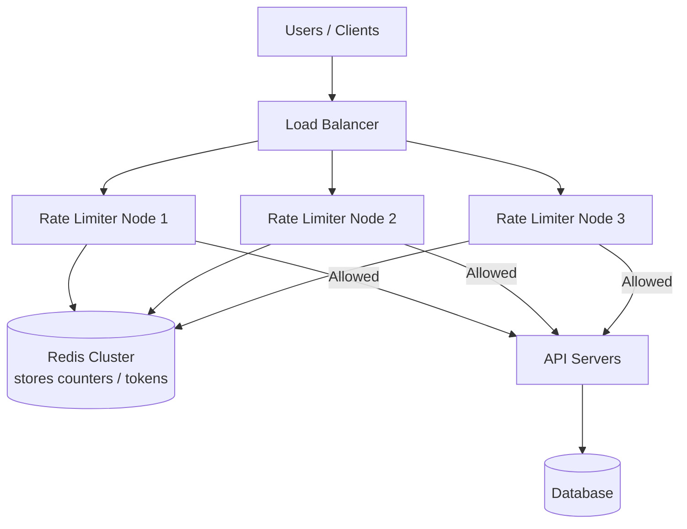

**Key points:**
- **Redis** is used because it is very fast and supports atomic operations (like increment and expire), so many rate limiter nodes can share the same counters safely.
- Rate limit **rules** (for example, "Free users: 100 requests per minute") are stored in a configuration service and loaded by the rate limiter nodes.
- The rate limiter should add very **little latency** (usually a few milliseconds).

### 6.1 Why Redis Instead of Local Memory?

A common question: *"Why do we store request counts in Redis? Why not just keep them in the application's memory?"*

The answer comes down to one problem: **when there are many servers, each server only sees its own requests.**

Suppose we have three backend instances behind a load balancer, and the limit is **100 requests per minute per user**.

```
             Load Balancer
             /     |     \
            /      |      \
        Server1  Server2  Server3
```

If each server stores counters in its **local application memory**:

| Server | Local counter for User 101 | Limit | Decision |
|---|---|---|---|
| Server 1 | 50 | 100 | Allowed (50 < 100) |
| Server 2 | 40 | 100 | Allowed (40 < 100) |
| Server 3 | 30 | 100 | Allowed (30 < 100) |

Every server thinks the user is **within the limit**. But the user has actually sent **50 + 40 + 30 = 120 requests**, which is more than the allowed 100. In the worst case, each server could allow 100 requests, letting **300 requests** through. The rate limit is broken.

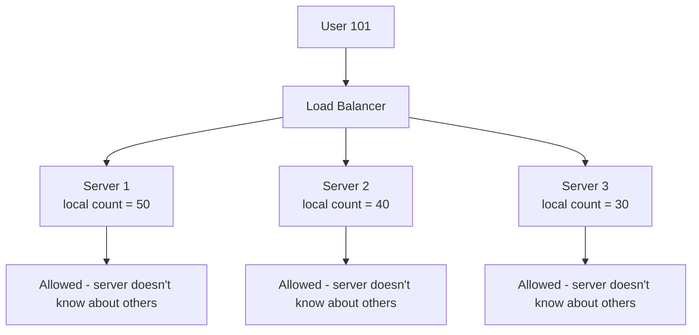

#### The Solution: One Shared Counter in Redis

Instead of each server keeping its own count, all servers store and update the **same counter in Redis**. Redis acts as the single source of truth.

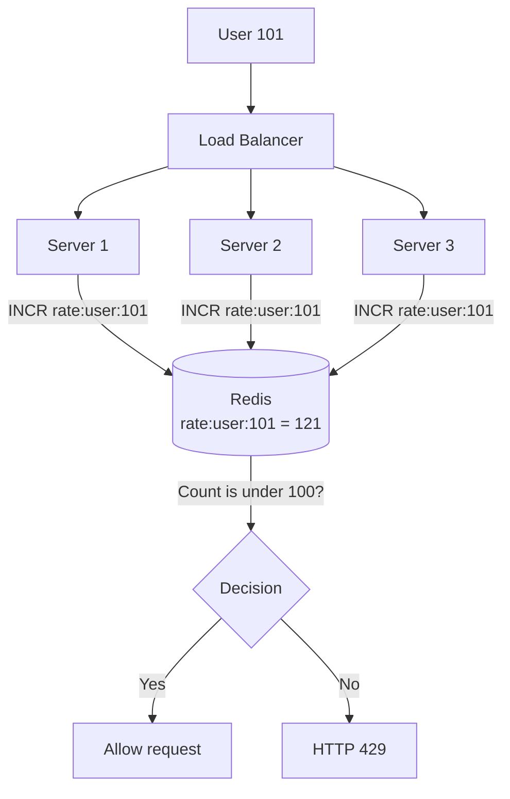

Now every server sees the **same global count**, no matter which server handles the request.

**Example logic (pseudocode):**

```
count = REDIS.INCR("rate:user:101")        // atomically add 1 and get new value
if count == 1:
    REDIS.EXPIRE("rate:user:101", 60)      // start a 60-second window
if count > 100:
    return HTTP 429 Too Many Requests      // over the limit
else:
    forward request to the backend
```

#### Why `INCR` Matters: Avoiding Race Conditions

Without atomic operations, two servers could read the same value at the same time:

1. Server 1 reads count = 99.
2. Server 2 reads count = 99 (before Server 1 writes back).
3. Both think "99 < 100, allow" and both write 100.
4. Two requests are allowed, but the counter only moved by one.

Redis `INCR` is **atomic**: it reads, adds 1, and writes in a single indivisible step. Each request gets a unique number (100, 101, 102...), so the limit is enforced correctly.

#### Other Reasons to Use Redis

| Reason | Local Memory | Redis |
|---|---|---|
| **Consistent limit across servers** | No, each server has its own count | **Yes**, one shared count |
| **Survives server restarts** | No, counters are lost on restart or crash | Yes (with persistence or replicas) |
| **Works with auto-scaling** | Poorly, new servers start at zero | Yes, new servers use the same counter |
| **Built-in expiry for time windows** | Must be coded manually | Yes, using `EXPIRE` / TTL |
| **Speed** | Fastest (no network call) | Very fast (sub-millisecond, in-memory store) |
| **Works with token bucket too** | Hard to share state | Yes, store tokens and last refill time in Redis (use a Lua script for atomic updates) |

**Note on "sticky sessions":** Some teams try to fix this by making the load balancer always send the same user to the same server. This is fragile. If that server crashes, scales down, or the user's IP changes, the counter is lost or split.

#### Trade-offs of Using Redis

- **Extra network hop:** Each request makes a call to Redis, which adds a small delay (usually under a millisecond or two inside the same data center).
- **Redis becomes a critical dependency:** If Redis goes down, the rate limiter is affected. Common fixes:
  - Use **Redis replicas or a Redis Cluster** for high availability.
  - Decide on a **failure policy**: *fail-open* (allow requests when Redis is down, favoring availability) or *fail-closed* (block requests, favoring protection).
- **Careful design needed:** Use atomic commands or Lua scripts so that multi-step updates (like the token bucket refill) stay correct.

**Summary:** Local memory works only for a **single server**. Once you have multiple servers, you need a **shared, fast, atomic store** like Redis so that every server enforces the same limit.

---

## 7. What Happens When a Request Is Blocked

When a request is blocked, the server should send a clear response:

- **HTTP Status Code:** `429 Too Many Requests`
- **Headers that help the client:**
  - `X-RateLimit-Limit`: maximum requests allowed in the window
  - `X-RateLimit-Remaining`: requests left in the current window
  - `X-RateLimit-Reset`: time when the limit resets
  - `Retry-After`: number of seconds the client should wait before retrying

**Example response:**

```http
HTTP/1.1 429 Too Many Requests
Retry-After: 30
X-RateLimit-Limit: 100
X-RateLimit-Remaining: 0
X-RateLimit-Reset: 1732180000
```

---

## 8. Summary

| Topic | Key Takeaway |
|---|---|
| **What** | Rate limiter controls how many requests a client can send in a time frame. |
| **Why** | Prevents overload, attacks, unfair usage, and high costs. |
| **Where** | Client-side (weak), Server-side (scattered), **Middleware-side (most used in industry)**. |
| **Based on** | **IP address** (for anonymous users) and **User ID** (for logged-in users). |
| **Algorithms** | **Token Bucket** (allows bursts) and **Leaky Bucket** (smooth output). |
| **Blocked requests** | Return HTTP `429 Too Many Requests` with helpful headers. |

---

*Note: Diagrams are written in [Mermaid](https://mermaid.js.org/) syntax. They render automatically on GitHub, GitLab, Notion, and many Markdown viewers.*